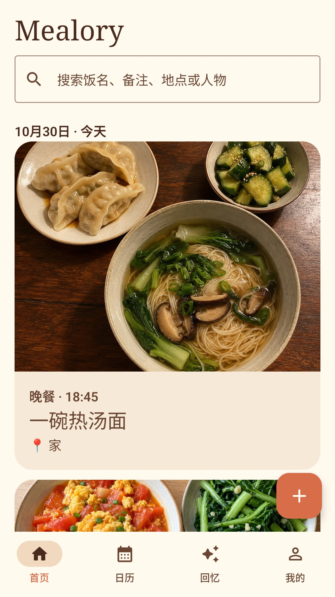
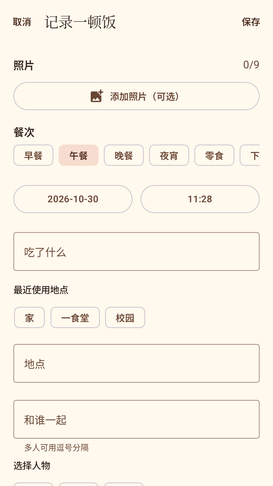
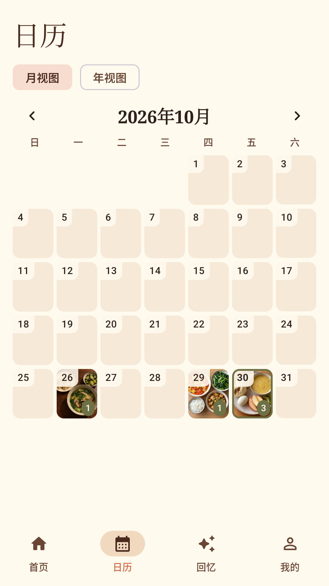
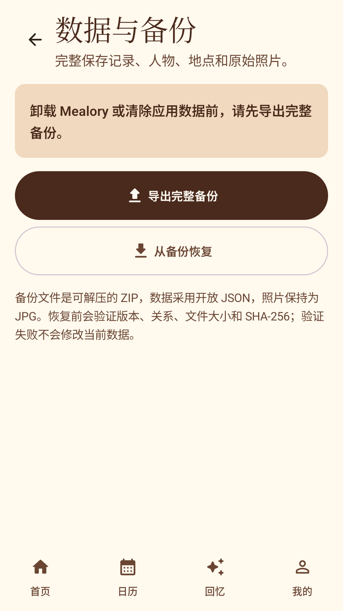

<div align="center">
  
  <h1>Mealory</h1>
  <p><strong>把吃过的每一顿饭，留给未来的自己。</strong></p>
  <p>一款私人、安静、完全离线的 Android 饮食回忆日记。</p>

  <p>
    
    
    
    
  </p>

  <p><em>MEALS TODAY, MEMORIES TOMORROW</em></p>
</div>

## 应用预览

<div align="center">
  
  
  
  
  
</div>

## 为什么是 Mealory

Mealory 不计算卡路里，不制造打卡压力，也不把私人饮食变成社交内容。它只做一件事：用照片、日期和少量文字，温柔地保存一顿饭背后的时间与关系。

| 记录 | 整理 | 回忆 | 守护数据 |
|---|---|---|---|
| 相机或相册添加照片，最多 9 张 | 时间线、搜索、日历、人物与地点 | 过去的今天、随机一顿、历年同月与年度回忆 | 最近删除、完整 ZIP 导出与验证恢复 |
| 支持无照片补记与 EXIF 时间 | 多照片封面、饭名、餐次和备注 | 所有内容均来自真实记录 | 开放 JSON + 原始 JPG，不锁定数据 |

## 隐私优先

- 无账号、无广告、无订阅、无服务器，也不申请网络权限。
- 不读取通讯录、定位或整个相册；相机和照片选择均使用 Android 系统能力。
- 数据库与照片只保存在应用私有目录，系统云备份默认关闭。
- 用户可随时导出可解压、可长期理解的完整 ZIP 备份。

> 卸载 Mealory 或清除应用数据会删除设备上的本地记录。操作前请前往“我的 → 数据与备份”导出完整备份。

## 技术实现

| 层级 | 技术 |
|---|---|
| UI | Kotlin、Jetpack Compose、Material 3、Navigation Compose |
| 数据 | Room、Paging 3、DataStore、Coroutines |
| 后台任务 | WorkManager |
| 图片 | Android Photo Picker、FileProvider、Coil、ExifInterface |
| 备份 | Storage Access Framework、JSON、ZIP、SHA-256 完整性校验 |
| 平台 | minSdk 26、targetSdk 37、Java 17、Gradle 9.6 |

项目采用单 Activity、单 `app` 模块结构。数据、照片归档、恢复事务和错误边界的设计说明见 [ARCHITECTURE.md](ARCHITECTURE.md)。

## 本地构建

### 环境要求

- Android Studio（包含 JDK 17 或更高版本）
- Android SDK Platform 37 与 Build Tools 37.0.0

### Windows

```powershell
$env:JAVA_HOME = 'C:\Program Files\Android\Android Studio\jbr'
$env:ANDROID_HOME = "$env:LOCALAPPDATA\Android\Sdk"
.\gradlew.bat testDebugUnitTest lintDebug assembleDebug
```

Debug APK 会生成在 `app/build/outputs/apk/debug/app-debug.apk`。设备测试需要先连接模拟器或 Android 手机，再运行：

```powershell
.\gradlew.bat connectedDebugAndroidTest
```

### macOS / Linux

```bash
./gradlew testDebugUnitTest lintDebug assembleDebug
```

正式 Release 构建需要本地签名材料；密钥和密码永远不应提交到仓库。示例配置见 `keystore.properties.example` 与 `release.properties.example`。

## 质量状态

- 5 个 JVM 测试与 20 个设备测试通过。
- `lintDebug`、Debug/Release 构建与签名校验通过。
- 已在 API 37 模拟器和 OPPO Reno12（Android 15）完成真机验收。
- 相机、Photo Picker、ZIP 备份/完整替换恢复和冷启动均已实际验证。

推送或提交 Pull Request 时，GitHub Actions 会自动运行单元测试、Lint 和 Debug 构建。

## 项目文档

- [产品需求](PRD.md)：V1 范围、交互原则与验收要求
- [架构设计](ARCHITECTURE.md)：数据、照片、备份和模块设计
- [技术决策](DECISIONS.md)：重要取舍及其理由
- [项目状态](PROJECT_STATUS.md)：阶段记录、验证结果和后续计划
- [贡献指南](CONTRIBUTING.md)：反馈问题与参与开发的约定
- [安全说明](SECURITY.md)：安全问题的私下报告方式

## 路线图

- [x] V1 核心记录、整理和回忆体验
- [x] 本地隐私设计与开放备份恢复
- [x] 模拟器、自动化测试和 OPPO 真机验收
- [x] 1.0.0 正式签名包验证
- [ ] 根据真实使用反馈继续打磨体验与无障碍支持

## 反馈与使用许可

欢迎通过 Issue 提交问题、建议或体验反馈。代码贡献需要事先获得项目所有者同意，具体说明见 [CONTRIBUTING.md](CONTRIBUTING.md)。

本仓库公开用于项目展示与学习参考，但并非开源软件。版权归白子豪所有，未经书面许可，不得复制、修改、分发、商业使用或创建衍生作品。完整条款见 [LICENSE](LICENSE)。
